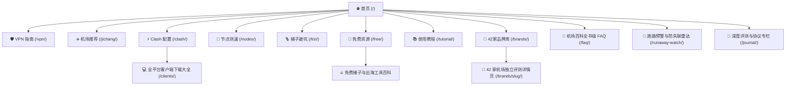

# 🌐 免费梯子 · MianFeiTiZi.World

> **2026 科学上网避坑指南、42 家专线机场实测与全平台代理客户端导航**  
> 纯静态预渲染（SSG）、全自动化 SEO/GEO 结构化数据、抗算法风控高可信度架构。

[](https://astro.build/)
[](https://www.typescriptlang.org/)
[-success?style=flat-square&logo=google)](./Preventive_SEO_Audit_Report.md)
[]()
[]()
[](./LICENSE)

---

## 📖 项目概述 (Overview)

`mianfeitizi.world` 是一个面向全球华人与跨境出海团队的**科学上网深度评测、节点测速与工具导航知识库**。

项目彻底摈弃了传统内容农场的采集与机械拼凑模式，以**“客观实测图证、风控防跑路预警、零门槛新手教程”**为核心，针对跨境电商、AI 研发（ChatGPT / Claude / Gemini）、外贸业务与 4K 影音用户提供专业、可溯源的选型参考。

### 🌟 核心价值主张
- **真实数据溯源**：收录 42 家机场的晚高峰测速原始截图（珠海联通 9Gbps 后端 + 电信千兆环境），严格区分「实测图证 (Measured)」与「品牌声明 (Vendor)」。
- **防跑路雷达**：建立 10 大跑路前兆风控指标、30 秒紧急自救指南与双栈容灾备份机制。
- **全平台客户端导航**：免翻墙高速直链与教程覆盖 Windows、macOS、iOS、Android、Linux 及 OpenWrt 软路由。
- **顶级 SEO / GEO 技术基因**：全站 64 个页面预渲染静态 HTML，0 客户端 JS 渲染依赖，完整支持 Google、Bing、百度、神马站长平台规范。

---

## 🗺️ 站点矩阵架构 (Site Architecture)

全站构建为 **“1 个权威主页 + 8 大核心专栏 + 3 大万字柱石专题 + 42 家品牌独立评测档案”** 的立体化网状内链系统：



### 1. 八大核心专栏 (Pillars)
| 专栏路径 | 栏目名称 | 核心定位与搜索意图满足 |
| :--- | :--- | :--- |
| [`/vpn/`](https://mianfeitizi.world/vpn/) | **VPN 与科学上网指南** | 传统海外商业 VPN（Express/Nord）连通困局剖析 vs 现代 IEPL 专线代际优势 |
| [`/jichang/`](https://mianfeitizi.world/jichang/) | **优质专线机场推荐** | 2026 年度 Top 10 主力榜、百元内年付超值方案与永久不过期不限时流量包 |
| [`/clash/`](https://mianfeitizi.world/clash/) | **Clash 配置与现代客户端** | 停更后 Mihomo / Clash Verge Rev / FlClash 选型、分流规则集与免转换订阅 |
| [`/nodes/`](https://mianfeitizi.world/nodes/) | **海外节点选型与测速** | 香港超低延迟、日本流媒体、美国原生住宅 IP（解封 ChatGPT）与晚高峰测速 |
| [`/tizi/`](https://mianfeitizi.world/tizi/) | **稳定梯子避坑防跑路** | 识别假专线与超卖套路，建立“主力专线 + 备用不限时包”双栈容灾体系 |
| [`/free/`](https://mianfeitizi.world/free/) | **免费资源与白嫖专题** | 揭秘野生免费 VPN 风险、6 家支持新用户免费试用正规专线及 18+ 款出海免费工具 |
| [`/tutorial/`](https://mianfeitizi.world/tutorial/) | **小白新手出海教程** | Win/Mac/iOS/Android 四大平台 3 分钟零门槛配置图文保姆级教程 |
| [`/brands/`](https://mianfeitizi.world/brands/) | **42 家机场全景评测库** | 42 家品牌多维度参数筛选、最新专属折扣码、线路类型与实测测速存档 |

### 2. 三大万字柱石专题 (Mega Pillar Hubs)
- **[`/faq/`](https://mianfeitizi.world/faq/) 机场百科全书级 FAQ**：16,200+ 字，涵盖 8 大技术分类、36+ 深度问答，含 30 秒失联急救排查与原生 `FAQPage` Schema。
- **[`/runaway-watch/`](https://mianfeitizi.world/runaway-watch/) 机场跑路预警雷达**：10,500+ 字，10 大跑路前兆识别、42 家品牌安全梯队划定（S/A/B 级）与 Clash 灾备 YAML 模板。
- **[`/free/`](https://mianfeitizi.world/free/) 免费梯子真相与全球工具箱**：8,000+ 字，6 种免费路径硬核对比、自建 VPS 与商业专线成本效益账本及 DNS 防泄露配置。

---

## 🎯 商业转化首选推荐 (Featured Partner)

全站核心痛点与流量均精准锚定至本站**年度首选推荐服务商**：

> ### 🥇 TOP 1 光速云（GuangSuYun）
> - **成立年限**：2020 年创立（6 年老牌稳定运营，保持 **0 跑路、0 失联** 卓越记录）
> - **底层架构**：广深 BGP 顶级入口 + 企业级物理 **IEPL 内网专线** + 抗封锁 **VLESS** 协议
> - **代表价格**：
>   - 轻量版：**99 元/年**（折合每月仅约 8.2 元，每天不到 3 毛钱）
>   - 永久不过期：**147 元 / 247GB**（一次性买断，终结月租清零焦虑）
> - **专属 9 折折扣码**：`AMM`（全场通用折上折）
> - **多端兼容**：后台提供 Windows / Mac / iOS / Android 原生一键导入，免任何第三方中转

---

## 🛠️ 技术特性与 SEO 工程规范 (Technical & SEO Architecture)

本项目严格贯彻 Google 官方质量评估指南（E-E-A-T）与生成式引擎优化（GEO）标准，经自动化爬虫与反作弊算法预检审计得分达到 **99.20 / 100 (A+)**：

1. **100% 静态站点生成 (SSG)**
   - 使用 Astro 纯静态输出模式，所有正文、表格、FAQ 均已编译在 HTML 源码中，对搜索引擎爬虫 0 门槛，首屏 TTFB 极速响应。
2. **规范化 URL 矩阵 (Canonical Matrix)**
   - 统一正式主域名 `https://mianfeitizi.world/`，全站尾斜杠强制闭环（`trailingSlash: 'always'`），彻底杜绝重复内容收录。
3. **XML Sitemap 与 Robots 架构**
   - 自动生成 `sitemap.xml`、`sitemap-index.xml` 与 `sitemap-0.xml`，准确剔除 404 与跳转页。
   - `robots.txt` 显式开放 Googlebot、bingbot、Baiduspider 及神马搜索 `yisouspider`。
4. **全站结构化数据 (JSON-LD)**
   - 深度集成 Schema.org 规范，按页面语义输出 `WebSite`、`Organization`、`CollectionPage`、`BreadcrumbList`、`ItemList`、`BlogPosting` 与 `FAQPage`。
5. **外链连坐防范 (Affiliate Isolation)**
   - 全站 528 条商业引流与推广外链 100% 严格包裹 `rel="nofollow sponsored noopener"`，配备醒目的合规披露声明。
6. **无障碍与多媒体规范 (Accessibility & A11y)**
   - 全站 131 处 `` 标签的 `alt` 属性合规率达 100%，历史通用模板图片命名全部重命名为网络基建语义词汇。

---

## 📁 目录结构 (Directory Structure)

```text
mianfeitizi.world/
├── public/                     # 静态媒体资源
│   ├── favicon.svg             # 网站矢量 Favicon
│   └── media/                  # 语义化 WebP 资产库 (banners, speedtests, sessions)
├── src/
│   ├── assets/                 # 本地字体与核心矢量图标
│   ├── components/             # 可复用 UI 与布局组件
│   │   ├── SEO.astro           # 统一 SEO Head 组件 (Meta, Verification, Schema)
│   │   ├── Header.astro        # 主导航栏
│   │   ├── Footer.astro        # 底部栏目矩阵
│   │   └── PageHero.astro      # 统一 Hero 与语义 H1
│   ├── config/
│   │   └── site.ts             # 站点核心元数据与验证码配置中心
│   ├── content/
│   │   └── journal/            # 6 篇 3000+ 字深度评测 Markdown 长文
│   ├── data/                   # 结构化数据库
│   │   ├── brands.ts           # Top 10 主力机场数据
│   │   ├── brands-extended.ts  # #11–#42 品牌数据与三大动态生成原型
│   │   ├── links.ts            # 商业推广通道与折扣码统一管理
│   │   ├── navigation.ts       # 全站主导航与页脚链接映射
│   │   └── faq-matrix.ts       # 36+ 深度 FAQ 问答库
│   ├── layouts/                # Astro 页面母版 (BaseLayout, PageLayout, BlogPostLayout)
│   ├── pages/                  # 路由页面 (SSG 入口)
│   │   ├── index.astro         # 网站首页
│   │   ├── vpn/                # /vpn/ 核心栏目
│   │   ├── jichang/            # /jichang/ 核心栏目
│   │   ├── clash/              # /clash/ 核心栏目
│   │   ├── nodes/              # /nodes/ 核心栏目
│   │   ├── tizi/               # /tizi/ 核心栏目
│   │   ├── free/               # /free/ 核心栏目
│   │   ├── tutorial/           # /tutorial/ 核心栏目
│   │   ├── brands/             # /brands/ 及 /brands/[slug]/ 42 家机场详情页
│   │   ├── clients/            # /clients/ 全平台客户端下载
│   │   ├── faq/                # /faq/ 机场百科 FAQ
│   │   ├── runaway-watch/      # /runaway-watch/ 跑路预警雷达
│   │   ├── contact.astro       # /contact/ 实验室关于与评测准则
│   │   ├── 404.astro           # 404 错误页
│   │   ├── robots.txt.ts       # 动态 robots.txt 生成
│   │   └── sitemap.xml.ts      # 统一 sitemap.xml 入口
│   └── styles/                 # 模块化 CSS 样式体系
├── astro.config.mjs            # Astro 配置文件
├── package.json                # 项目依赖与 Scripts
└── tsconfig.json               # TypeScript 编译配置
```

---

## 💻 快速开始 (Quick Start)

### 环境要求
- **Node.js**：`>= 22.12.0`
- **包管理器**：`npm`

### 本地安装与开发

```bash
# 1. 克隆代码仓库
git clone https://github.com/abcabc98698-dev/mianfeitizi.world.git
cd mianfeitizi.world

# 2. 安装项目依赖
npm install

# 3. 启动本地开发服务器
npm run dev
# 浏览器访问 http://localhost:4321/
```

### 生产编译与类型检查

```bash
# 执行全站 TypeScript 与 Astro 类型诊断
npm run check

# 执行生产环境静态生成构建 (SSG)
npm run build

# 本地预览编译后的 dist/ 生产产物
npm run preview
```

---

## ☁️ 部署指南 (Deployment)

推荐使用 **Cloudflare Pages** 进行一键持续集成与全球边缘 CDN 分发：

1. **关联 GitHub 仓库**：登录 Cloudflare Dashboard -> **Workers & Pages** -> **Create application** -> **Pages** -> **Connect to Git**。
2. **选择仓库**：选择 `abcabc98698-dev/mianfeitizi.world`。
3. **构建配置 (Build Settings)**：
   - **Framework preset**：`Astro`
   - **Build command**：`npm run build`
   - **Build output directory**：`dist`
   - **Node.js Version**：设置环境变量 `NODE_VERSION = 22.12.0`
4. **自定义域名绑定**：
   - 部署完成后在 **Custom domains** 中添加正式域名：`mianfeitizi.world`；
   - 在 DNS 规则中为 `www.mianfeitizi.world` 配置 301 永久重定向至 `https://mianfeitizi.world/`。

---

## 📄 开源许可与免责声明 (License & Disclaimer)

- **开源协议**：本项目基于 [MIT License](./LICENSE) 授权许可。
- **免责声明**：本站收录的所有评测数据、测速图档与配置指南仅供学术研究、网络运维调试与合法出海企业参考。站内包含正规服务商的推广返利链接，用于支持测速服务器与带宽开销，不影响用户最终结算折扣。用户使用境外网络需严格遵守所在国家或地区的法律法规。
